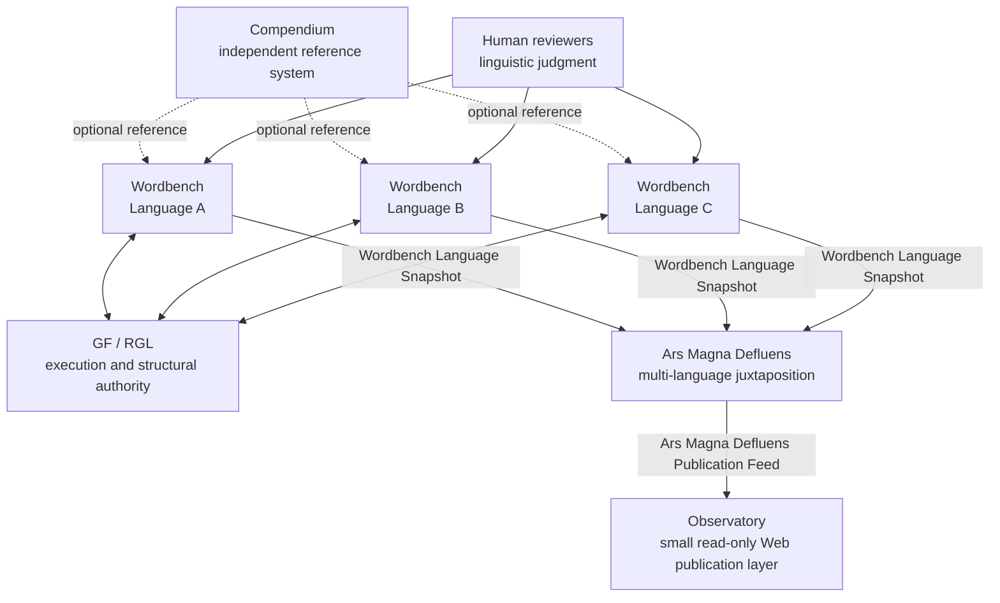

<!-- Ecosystem alignment reference; original source in snapshot root, public name updated 2026-11-03. -->

---
title: "Global Alignment Specification"
subtitle: "A Wordbench-Centered Architecture for Compendium, Wordbench, Ars Magna Defluens, and Observatory"
version: "2.0"
date: "2026-07-26"
status: "Normative target architecture"
language: "en"
---

# Global Alignment Specification

> **Canonical rule:** Wordbench is the operational center. It defines and proves the state of one GF language project. Ars Magna Defluens aligns to Wordbench in order to juxtapose many language projects. Observatory aligns to Ars Magna Defluens in order to publish that juxtaposition. Compendium remains independent.

---

## 1. Purpose

This document defines the global alignment of four distinct systems:

1. **Compendium**
2. **Wordbench**
3. **Ars Magna Defluens**
4. **Observatory**

The systems are not peers with interchangeable responsibilities.

The operational chain is centered on **Wordbench**:

```text
Wordbench
   ↓
Ars Magna Defluens
   ↓
Observatory
```

Compendium is outside that chain:

```text
Compendium
   independent reference system
```

The purpose of the alignment is to guarantee that:

- one language is developed and validated in one Wordbench context;
- Wordbench remains the source of truth for that language’s technical state;
- Ars Magna Defluens can juxtapose many Wordbench language records without changing their meaning;
- Observatory can publish Ars Magna Defluens through a small, read-only Web interface;
- GF remains the execution authority;
- linguistic judgments remain attributable to qualified human reviewers;
- no downstream system silently recalculates or upgrades a Wordbench conclusion.

This document specifies the target architecture. It does not claim that every described component is already implemented.

---

## 2. Normative language

The terms **MUST**, **MUST NOT**, **SHOULD**, **SHOULD NOT**, and **MAY** are normative.

- **MUST / MUST NOT**: required for alignment.
- **SHOULD / SHOULD NOT**: strongly recommended; deviations require a documented reason.
- **MAY**: optional.

---

## 3. Source-grounded premises

This alignment preserves the following established premises from the current documentation.

### 3.1 Wordbench premises

Wordbench is designed as:

- a development, validation, diagnostic, regression, and release-preparation environment;
- a language-neutral framework operating on **one active language project**;
- an orchestrator of native GF execution rather than a replacement for GF;
- a producer of structured results, raw evidence, manifests, diagnostics, scenario outputs, gold comparisons, compiled artifacts, and release gates;
- a system that distinguishes compilation, behavior, regression, publication readiness, and linguistic approval.

Its current documented lifecycle is:

```text
initialize
→ establish baseline
→ develop
→ validate checkpoint
→ stabilize
→ publish
→ archive or replace
```

Its validation modes are:

```text
quick
checkpoint
diagnostic
release
```

### 3.2 Ars Magna Defluens premise

Ars Magna Defluens exists to place the outputs of multiple independent Wordbench language projects side by side.

It is the multi-language juxtaposition and aggregation layer.

### 3.3 Observatory premise

Observatory is intentionally small.

Fundamentally, it is a Web publication layer that:

- reads Ars Magna Defluens;
- displays Ars Magna Defluens;
- exposes the published language catalog and maturity information;
- contains minimal business logic.

### 3.4 Compendium premise

Compendium is an independent documentation, retrieval, engineering, and governance reference for GF/RGL language work.

It does not need to conform to the Wordbench–Ars Magna Defluens–Observatory runtime chain.

---

# 4. Canonical architecture

## 4.1 System map



## 4.2 Architecture formula

```text
Compendium  = independent engineering reference

Wordbench   = one language, one validation context,
              one authoritative language state

Ars Magna Defluens   = many Wordbench language states,
              juxtaposed without reinterpretation

Observatory = a small Web page that reads and displays Ars Magna Defluens
```

## 4.3 Direction of alignment

Alignment is downstream.

```text
Wordbench does not conform to Observatory.
Observatory conforms to Ars Magna Defluens.

Wordbench does not conform to Ars Magna Defluens’s presentation needs.
Ars Magna Defluens conforms to Wordbench’s published language contract.
```

Wordbench is therefore the semantic center of the operational architecture.

Ars Magna Defluens and Observatory MUST adapt to Wordbench. They MUST NOT force Wordbench to weaken, flatten, or distort its validation model.

---

# 5. Authority model

## 5.1 Authority table

| Question | Authority |
|---|---|
| Does GF accept the source? | GF, invoked and recorded by Wordbench |
| Does a checkpoint compile? | Wordbench, using GF evidence |
| Does a required scenario pass? | Wordbench |
| Did a linearization or parse behavior change? | Wordbench |
| Is a gold comparison unchanged, improved, or regressed? | Wordbench |
| Is an artifact tied to the exact source state? | Wordbench manifest and hashes |
| Is a linguistic output correct or acceptable? | Qualified human reviewer |
| What is the state of one language project? | Wordbench |
| How are several language states juxtaposed? | Ars Magna Defluens |
| What is publicly displayed? | Ars Magna Defluens publication data, rendered by Observatory |
| May Observatory change a verdict? | No |
| May Ars Magna Defluens recompute a Wordbench verdict? | No |
| Must Compendium participate in execution? | No |

## 5.2 GF remains the execution authority

Wordbench MUST call GF for the operations that belong to GF, including:

- parsing;
- linearization;
- generation;
- type checking;
- module resolution;
- compilation;
- morphology inspection;
- PGF construction.

Wordbench MAY perform static scans, preparation, classification, normalization, comparison, reporting, and policy evaluation.

Wordbench MUST NOT present a static scan as equivalent to a native GF result.

## 5.3 Human linguistic authority

A successful technical test does not prove universal linguistic truth.

Wordbench MUST distinguish at least:

```text
machine_observed
maintainer_declared
human_reviewed
expert_validated
upstream_accepted
```

Ars Magna Defluens and Observatory MUST preserve these distinctions.

---

# 6. Compendium: independent by design

## 6.1 Position

Compendium is not a component of the operational publication pipeline.

It MAY be used by:

- a developer;
- a reviewer;
- an AI assistant;
- a Wordbench operator;
- an upstream contributor.

It is not required for:

- Wordbench to execute GF;
- Ars Magna Defluens to ingest a Wordbench snapshot;
- Observatory to display Ars Magna Defluens.

## 6.2 Independence requirements

Compendium:

- MUST have its own repository and versioning;
- MUST NOT be a mandatory runtime dependency of Wordbench;
- MUST NOT be a mandatory data dependency of Ars Magna Defluens;
- MUST NOT be required by Observatory;
- MAY evolve on a separate release schedule;
- MAY define engineering guidance without controlling downstream publication;
- MUST NOT be treated as proof that a language compiles or is linguistically correct.

## 6.3 Alignment scope

This global alignment specification does not require Compendium to change its internal architecture.

Only two interoperability conventions are recommended:

1. When Compendium refers to a Wordbench result, it SHOULD identify the exact Wordbench run, source revision, GF version, and evidence reference.
2. When Wordbench records that Compendium guidance was used, it SHOULD record the Compendium version as contextual provenance, not as execution proof.

## 6.4 Historical naming

The active product name is **Compendium**.

Obsolete names such as **Codex** SHOULD be removed from current architecture documents. Historical documents MAY retain the old name when clearly marked as historical.

---

# 7. Wordbench: the operational center

## 7.1 One-language invariant

The central invariant is:

> **One Wordbench workspace equals one active GF language project.**

Wordbench software may be language-neutral and reusable across languages. A running workspace, project context, validation state, or release bundle MUST nevertheless refer to one language only.

A Wordbench workspace MUST identify:

- one language identity;
- one source root;
- one project configuration;
- one GF toolchain context;
- one RGL revision;
- one set of entrypoints;
- one set of checkpoints;
- one scenario set;
- one gold set;
- one current source state.

## 7.2 Wordbench responsibilities

Wordbench MUST be responsible for the complete technical evidence chain of one language:

1. resolve configuration;
2. identify the exact source state;
3. identify GF and RGL versions;
4. select files, checkpoints, entrypoints, and scenarios;
5. invoke GF;
6. preserve stdout, stderr, commands, exit codes, timings, and paths;
7. distinguish direct, downstream, ambiguous, and non-actionable failures;
8. execute `.gfs` scenarios;
9. normalize only authorized non-linguistic noise;
10. compare outputs with reviewed golds;
11. build and verify required `.gfo` and `.pgf` artifacts;
12. compare compatible runs;
13. apply Wordbench gates;
14. produce immutable reports and manifests;
15. publish a structured language snapshot when the project policy permits it.

## 7.3 Wordbench non-responsibilities

Wordbench MUST NOT:

- aggregate several languages into one mutable project;
- function as the public multi-language catalog;
- modify source code autonomously;
- accept a new gold silently;
- infer linguistic truth from compilation alone;
- declare a proposed correction validated before retesting;
- allow Ars Magna Defluens or Observatory to overwrite its evidence;
- tailor its internal validation semantics to a visual dashboard.

## 7.4 Wordbench evidence hierarchy

Within one project, evidence SHOULD be interpreted in the following order:

1. exact source identity;
2. exact GF and RGL identity;
3. native GF result;
4. reproducible scenario result;
5. reviewed gold comparison;
6. human linguistic review;
7. Wordbench gate decision;
8. human-readable summary.

A summary MUST NOT outrank the structured result or raw evidence from which it was produced.

---

# 8. Canonical Wordbench outputs

## 8.1 Existing run artifacts

A Wordbench run SHOULD preserve, as applicable:

```text
summary.json
summary.md
AI_READY.md
top_errors.txt
manifest.json
raw/
artifacts/gfo/
artifacts/pgf/
```

`summary.json` is the machine-readable result of the run.

`manifest.json` establishes identity and integrity.

`raw/` contains the execution evidence.

`artifacts/` contains the products associated with the exact run.

## 8.2 Two distinct export levels

Wordbench MUST distinguish:

### A. RunBundle

A `RunBundle` represents one execution.

It may be:

- successful;
- failed;
- incomplete;
- diagnostic;
- local;
- checkpoint-level;
- release-level.

### B. LanguageSnapshot

A `LanguageSnapshot` represents the state of one language that Wordbench authorizes for external aggregation.

Ars Magna Defluens MUST consume `LanguageSnapshot`, not arbitrary mutable project state.

```text
Wordbench project
    ↓
RunBundle
    ↓ Wordbench selection and policy
LanguageSnapshot
    ↓
Ars Magna Defluens
```

## 8.3 LanguageSnapshot minimum contract

A language snapshot MUST identify:

```yaml
schema_version: "..."
snapshot_id: "..."
language:
  code: "sqi"
  name: "Albanian"

wordbench:
  version: "..."
  project_id: "..."
  run_id: "..."
  validation_mode: "release"

source:
  repository: "..."
  revision: "..."
  source_hash: "..."

toolchain:
  gf_version: "..."
  rgl_revision: "..."

state:
  lifecycle_stage: "..."
  overall_status: "..."
  publication_status: "..."

maturity:
  axes: [...]
  gates: [...]

reviews: [...]
known_issues: [...]
artifacts: [...]
evidence: [...]
generated_at: "..."
```

The exact field names MAY differ, but the semantics MUST be preserved.

## 8.4 Snapshot immutability

A published `LanguageSnapshot` MUST be immutable.

A change MUST produce a new snapshot.

A corrected snapshot MUST:

- have a new identifier;
- identify the snapshot it supersedes;
- preserve the historical record;
- retain the reason for replacement.

Ars Magna Defluens and Observatory MUST NOT silently replace the historical meaning of an existing snapshot.

---

# 9. Wordbench maturity model

## 9.1 Maturity is multidimensional

Wordbench MUST NOT reduce language maturity to one opaque percentage.

At minimum, it SHOULD represent the following axes separately:

| Axis | Core question |
|---|---|
| Identity and integrity | Are the exact project, source, configuration, and hashes known? |
| Toolchain | Are GF and RGL versions known and compatible? |
| Project structure | Are required modules, checkpoints, and entrypoints identified? |
| Morphology | Are paradigms, forms, irregulars, and lexical constructors implemented and tested? |
| Core syntax | Are the required syntactic constructors implemented and tested? |
| Extensions and missing coverage | Are `Extend`, `Extra`, `Symbolic`, and unsupported functions explicit? |
| Compilation | Do selected modules, checkpoints, and entrypoints compile? |
| Behavioral validation | Do parse, linearize, generation, morphology, and round-trip scenarios pass? |
| Regression | Are reviewed behaviors stable or intentionally changed? |
| Artifact readiness | Are required `.gfo` and `.pgf` artifacts current and verified? |
| Documentation and known issues | Are limitations, decisions, and unresolved problems explicit? |
| Human linguistic review | What has been reviewed, by whom, and over what scope? |
| Repeatability | Can the same source and configuration reproduce the result? |
| Release readiness | Are all mandatory Wordbench release gates satisfied? |
| Upstream readiness | Is the contribution reviewable and suitable for upstream submission? |

## 9.2 Every score requires a denominator

A percentage MUST state:

- the universe being measured;
- the numerator;
- the denominator;
- exclusions;
- evidence type;
- source revision;
- measurement date;
- limitations.

For example:

```yaml
metric_id: syntax.constructor_coverage
value: 0.91
implemented: 382
expected: 420
excluded: 7
scope: "locked RGL API revision ..."
evidence_type: machine_observed
```

A claim such as “100% of tests pass” is incomplete without test coverage.

## 9.3 Gates are not averages

A language MUST NOT pass a Wordbench stage because unrelated strengths compensate for a blocking failure.

For example, a language cannot be release-ready when:

- the required entrypoint fails;
- the current PGF is missing;
- a mandatory scenario fails;
- the source identity is unknown;
- the run does not match the published source;
- a critical known issue is undisclosed;
- a required human approval is absent.

These are gates, not weighted points.

## 9.4 Canonical lifecycle owner

Wordbench owns the lifecycle state of one language.

Ars Magna Defluens MUST preserve it.

Observatory MUST display it.

Neither may derive a more advanced lifecycle state from a visual score or an aggregate average.

---

# 10. Wordbench validation modes

## 10.1 Quick

Question:

> Does this limited change immediately break its local target?

Typical scope:

- selected file;
- static scan;
- local compilation;
- smoke scenario.

A quick result is not publication evidence.

## 10.2 Checkpoint

Question:

> Is this subsystem coherent at the selected milestone?

Typical scope:

- checkpoint module;
- dependencies;
- related scenarios;
- local regression evidence.

A checkpoint validates the checkpoint only.

## 10.3 Diagnostic

Question:

> Where is the first actionable failure and what does it block?

Typical scope:

- broad evidence collection;
- cause classification;
- dependency analysis;
- additional scenarios and logs.

A diagnostic result is explanatory, not a release authorization.

## 10.4 Release

Question:

> Is the evidence required by this Wordbench project complete and coherent enough for publication?

Typical scope:

- required entrypoints;
- required scenarios;
- reviewed golds;
- current PGF;
- manifest;
- repeatability;
- known issues;
- release gates;
- approvals.

Only Wordbench release policy may authorize creation of a publication-oriented `LanguageSnapshot`.

---

# 11. Failure and uncertainty semantics

## 11.1 Independent diagnostic axes

Wordbench SHOULD preserve separate fields for:

### Validation status

```text
OK
FAIL
ERROR
SKIPPED
```

### Execution state

```text
completed
timed_out
cancelled
launch_failed
```

### Error kind

Examples:

```text
TYPE
SYNTAX
TIMEOUT
SCRIPT
CONFIG
IO
TOOL
LINGUISTIC_OUTPUT
```

### Diagnostic class

```text
direct
downstream
ambiguous
noise
skipped
```

## 11.2 No downstream simplification

Ars Magna Defluens MUST preserve these distinctions.

Observatory MAY simplify their visual presentation, but MUST retain access to the underlying distinctions.

A timeout MUST NOT be displayed as a linguistic failure.

A downstream failure MUST NOT be counted as an independent root cause.

An ambiguous result MUST remain ambiguous.

## 11.3 Proposed, applied, validated

Changes MUST retain three distinct states:

```text
proposed
applied
validated
```

Only a Wordbench retest of the exact applied source may promote a change to `validated`.

---

# 12. Ars Magna Defluens: alignment to Wordbench

## 12.1 Core role

Ars Magna Defluens juxtaposes multiple independent Wordbench language states.

It answers:

> What languages have been developed in Wordbench, what state has each Wordbench published, and how can those states be compared without losing their original meaning?

## 12.2 Ingestion rule

Ars Magna Defluens MUST ingest only a documented Wordbench publication contract.

It MUST NOT:

- scrape Wordbench user interfaces;
- infer state from filenames;
- inspect mutable project directories as its primary source;
- reconstruct a maturity profile from raw logs;
- reinterpret a failed gate;
- promote a language beyond the Wordbench snapshot;
- merge two languages into one mutable validation state.

## 12.3 Juxtaposition, not validation

Ars Magna Defluens MAY:

- register multiple language snapshots;
- index versions;
- group by language family, status, maintainer, or revision;
- display comparable axes;
- track freshness;
- identify missing data;
- compare historical snapshots;
- expose evidence references;
- prepare publication feeds.

Ars Magna Defluens MUST NOT become a second Wordbench.

It does not own:

- GF execution;
- scenario success;
- gold acceptance;
- per-language gate logic;
- linguistic review;
- release validation.

## 12.4 Preservation rule

For every displayed Wordbench fact, Ars Magna Defluens MUST preserve:

- original value;
- original status;
- originating Wordbench version;
- snapshot identifier;
- run identifier;
- source revision;
- evidence reference;
- timestamp;
- schema version.

Ars Magna Defluens MAY derive presentation metadata, such as:

```text
fresh
aging
stale
superseded
retracted
```

Derived metadata MUST be clearly distinguished from Wordbench facts.

## 12.5 No hidden normalization

Ars Magna Defluens may normalize the transport envelope, identifiers, sorting, and catalog shape.

It MUST NOT normalize away semantic differences.

For example:

- `not_tested` is not `failed`;
- `unknown` is not `zero`;
- `partial_human_review` is not `machine_pass`;
- `checkpoint_validated` is not `release_ready`.

## 12.6 Multiple versions

Ars Magna Defluens MUST support more than one snapshot for a language.

A language record SHOULD include:

- current published snapshot;
- previous snapshots;
- superseded snapshots;
- retracted snapshots;
- available Wordbench versions;
- source revisions;
- publication dates.

The current snapshot MUST be selected by an explicit Ars Magna Defluens publication rule, not by silently choosing the newest file on disk.

---

# 13. Ars Magna Defluens canonical data model

## 13.1 Registry

Ars Magna Defluens SHOULD maintain a registry containing:

```yaml
language_id: "sqi"
display_name: "Albanian"
wordbench_source: "..."
current_snapshot_id: "..."
available_snapshot_ids: [...]
publication_state: "published"
```

## 13.2 Catalog record

A catalog record SHOULD contain:

```yaml
language:
  code: "sqi"
  name: "Albanian"

current_snapshot:
  id: "..."
  wordbench_run_id: "..."
  source_revision: "..."
  gf_version: "..."
  rgl_revision: "..."
  published_at: "..."

state:
  lifecycle_stage: "..."
  overall_status: "..."
  publication_status: "..."

maturity_axes: [...]
reviews: [...]
known_issues: [...]
artifact_links: [...]
evidence_links: [...]

ars_magna:
  ingestion_status: "accepted"
  ingested_at: "..."
  freshness: "fresh"
```

## 13.3 What Ars Magna Defluens may calculate

Ars Magna Defluens MAY calculate only clearly labeled aggregation metadata, such as:

- number of languages;
- number of snapshots;
- counts by Wordbench lifecycle stage;
- counts by publication status;
- number of stale records;
- number of languages missing human review;
- number of languages using a given GF or RGL version.

It MUST NOT calculate an undocumented global quality score.

---

# 14. Observatory: thin publication layer

## 14.1 Core role

Observatory is a small Web application that reads and displays Ars Magna Defluens.

Its core formula is:

```text
Observatory = read Ars Magna Defluens + render public views
```

## 14.2 Observatory responsibilities

Observatory MAY provide:

- a language index;
- one page per language;
- maturity-axis display;
- lifecycle-stage display;
- version and freshness information;
- known issues;
- review status;
- evidence links;
- artifact links;
- sorting and filtering;
- historical snapshot navigation;
- a compact global overview.

## 14.3 Observatory non-responsibilities

Observatory MUST NOT:

- invoke GF;
- execute Wordbench;
- inspect Wordbench repositories directly;
- ingest raw Wordbench runs directly;
- define maturity;
- recalculate gates;
- change a Wordbench result;
- decide which snapshot is current;
- accept linguistic reviews;
- become the system of record;
- contain hidden aggregation logic already owned by Ars Magna Defluens.

## 14.4 Read-only contract

Observatory MUST consume an Ars Magna Defluens publication feed.

Recommended forms include:

```text
catalog.json
languages/<code>.json
snapshots/<snapshot_id>.json
```

The transport may be static files, an API, or another read-only mechanism.

The semantics MUST remain the same:

- Ars Magna Defluens produces the public data;
- Observatory reads it;
- Observatory renders it.

## 14.5 Small-system principle

Observatory SHOULD remain replaceable.

A new front end should be able to render the same Ars Magna Defluens feed without changing:

- Wordbench;
- Wordbench language snapshots;
- Ars Magna Defluens’s stored records;
- the meaning of maturity fields.

This replaceability is a primary architectural quality.

---

# 15. End-to-end flow

## 15.1 Development flow

```text
Developer or reviewer
    ↓
one Wordbench language project
    ↓
GF execution
    ↓
RunBundle
    ↓
diagnosis, correction, retest
    ↓
Wordbench release evaluation
```

## 15.2 Publication flow

```text
Wordbench-authorized LanguageSnapshot
    ↓
Ars Magna Defluens schema and integrity validation
    ↓
Ars Magna Defluens registry and juxtaposition
    ↓
Ars Magna Defluens Publication Feed
    ↓
Observatory Web display
```

## 15.3 Compendium relationship

```text
Compendium
    ↓ optional guidance and engineering context
developer / reviewer / AI assistant
    ↓
Wordbench project
```

Compendium does not sit between Wordbench and Ars Magna Defluens.

---

# 16. Contract ownership

| Contract or object | Owner | Consumer |
|---|---|---|
| Wordbench project configuration | Wordbench project | Wordbench |
| RunBundle | Wordbench | Wordbench operators and diagnostics |
| Wordbench maturity semantics | Wordbench | Ars Magna Defluens, Observatory |
| LanguageSnapshot | Wordbench | Ars Magna Defluens |
| Snapshot history and catalog registry | Ars Magna Defluens | Observatory |
| Ars Magna Defluens Publication Feed | Ars Magna Defluens | Observatory |
| Web display model | Observatory | Public users |
| Engineering reference and workflows | Compendium | Optional human or AI consumers |
| Linguistic ReviewRecord | Qualified reviewer, stored with Wordbench state | Wordbench, then Ars Magna Defluens |
| GF execution result | GF, captured by Wordbench | Wordbench |

---

# 17. Versioning and compatibility

## 17.1 Wordbench contract version

Every `LanguageSnapshot` MUST identify its schema version.

Ars Magna Defluens MUST declare which Wordbench snapshot schema versions it supports.

## 17.2 Ars Magna Defluens feed version

Every publication feed MUST identify its Ars Magna Defluens feed schema version.

Observatory MUST declare which feed versions it supports.

## 17.3 Independent releases

The systems MUST remain independently releasable.

- Compendium may change without an Observatory release.
- Wordbench may change internally without Ars Magna Defluens changes if its published contract remains compatible.
- Ars Magna Defluens may change storage or aggregation internals without a Wordbench release.
- Observatory may be redesigned without changing Ars Magna Defluens’s semantic contract.

## 17.4 Compatibility failure

When Ars Magna Defluens receives an unsupported Wordbench snapshot, it MUST reject or quarantine it explicitly.

When Observatory receives an unsupported Ars Magna Defluens feed, it MUST fail visibly or display an explicit compatibility error.

Neither system may guess the meaning of unknown fields.

---

# 18. Provenance and integrity

## 18.1 Required identity chain

A public fact SHOULD be traceable through:

```text
Observatory display
    ↓
Ars Magna Defluens catalog record
    ↓
Wordbench LanguageSnapshot
    ↓
Wordbench RunBundle
    ↓
raw GF evidence and artifacts
    ↓
exact source revision and toolchain
```

## 18.2 Hashes

Wordbench SHOULD hash:

- source selections;
- configuration;
- raw outputs;
- normalized outputs;
- gold references;
- generated artifacts;
- reports.

Ars Magna Defluens SHOULD preserve the Wordbench hashes and MAY add hashes for its own catalog records.

Observatory need not generate new validation hashes.

## 18.3 No silent mutation

No system may silently alter evidence owned by an upstream system.

Corrections require:

- a new Wordbench run;
- a new Wordbench snapshot;
- a new or updated Ars Magna Defluens catalog state;
- a refreshed Observatory view.

---

# 19. Publication and retraction

## 19.1 Publication authority

Wordbench decides whether one language snapshot satisfies its publication policy.

Ars Magna Defluens decides whether a valid Wordbench snapshot is admitted to its catalog.

These are different decisions:

```text
Wordbench: technically publishable language state
Ars Magna Defluens: accepted catalog entry
```

Observatory does not make either decision.

## 19.2 Retraction

A snapshot may be marked:

```text
active
superseded
retracted
archived
```

Retraction MUST preserve:

- the original snapshot;
- the reason;
- the time;
- the responsible actor;
- the replacement snapshot, when applicable.

Observatory MUST display retraction status and MUST NOT present a retracted snapshot as current.

---

# 20. Security and trust boundaries

## 20.1 Wordbench

Wordbench may require write access to its own project or execution workspace.

It MUST isolate one language project from another.

## 20.2 Ars Magna Defluens

Ars Magna Defluens SHOULD consume immutable or signed Wordbench exports.

It SHOULD NOT require write access to Wordbench language sources.

## 20.3 Observatory

Observatory SHOULD operate with read-only access to Ars Magna Defluens’s publication feed.

It SHOULD NOT hold:

- Wordbench write credentials;
- source-repository write credentials;
- release approval credentials;
- linguistic-review authority.

---

# 21. Required documentation revisions

## 21.1 Compendium

No global alignment revision is required.

Optional maintenance:

- replace obsolete active-product references to `Codex` with `Compendium`;
- mark historical names clearly;
- preserve independence from the operational chain.

## 21.2 Wordbench

Wordbench documentation SHOULD add or confirm:

```text
README.md
docs/architecture/ONE_LANGUAGE_INVARIANT.md
docs/architecture/EXTERNAL_BOUNDARY.md
docs/reports/RUN_BUNDLE.md
docs/reports/LANGUAGE_SNAPSHOT.md
docs/maturity/MATURITY_MODEL.md
docs/publication/PUBLICATION_POLICY.md
docs/integration/ARS_MAGNA_CONTRACT.md
```

The documentation MUST state:

> One Wordbench workspace has one active language project.

It MUST also define:

- the canonical language snapshot;
- maturity-axis semantics;
- gate ownership;
- evidence links;
- immutability;
- version compatibility.

## 21.3 Ars Magna Defluens

Ars Magna Defluens documentation SHOULD include:

```text
README.md
docs/PRODUCT_OVERVIEW.md
docs/WORDbench_INGESTION.md
docs/LANGUAGE_REGISTRY.md
docs/JUXTAPOSITION_MODEL.md
docs/SNAPSHOT_HISTORY.md
docs/PUBLICATION_FEED.md
docs/COMPARISON_SEMANTICS.md
docs/PROVENANCE.md
docs/FAILURE_AND_QUARANTINE.md
docs/NON_GOALS.md
```

Its README MUST state:

> Ars Magna Defluens juxtaposes the published states of multiple independent Wordbench language projects.

## 21.4 Observatory

Observatory documentation can remain compact:

```text
README.md
docs/ARS_MAGNA_FEED.md
docs/ROUTING_AND_VIEWS.md
docs/RENDERING_SEMANTICS.md
docs/DEPLOYMENT.md
docs/NON_GOALS.md
```

Its README MUST state:

> Observatory is a small read-only Web publication layer that reads and displays Ars Magna Defluens.

---

# 22. Acceptance criteria

## 22.1 Wordbench acceptance

Wordbench is aligned when:

- one workspace cannot ambiguously represent two active languages;
- every run identifies source, toolchain, configuration, and mode;
- raw GF evidence is preserved;
- maturity axes and gates are explicit;
- a language snapshot can be produced deterministically;
- a snapshot is immutable and evidence-linked;
- publication does not depend on Ars Magna Defluens or Observatory.

## 22.2 Ars Magna Defluens acceptance

Ars Magna Defluens is aligned when:

- it ingests valid Wordbench language snapshots;
- it rejects or quarantines invalid or incompatible snapshots;
- it can hold several languages and several versions per language;
- it preserves Wordbench values without reinterpretation;
- it distinguishes missing, failed, unknown, and not-tested states;
- it produces a stable publication feed;
- it does not execute GF or reproduce Wordbench validation.

## 22.3 Observatory acceptance

Observatory is aligned when:

- it can be deployed from the Ars Magna Defluens publication feed alone;
- it does not need direct access to Wordbench;
- it does not contain maturity or gate logic;
- every displayed technical claim comes from Ars Magna Defluens;
- evidence and version links remain available;
- the front end can be replaced without changing Wordbench or Ars Magna Defluens.

## 22.4 Compendium acceptance

Compendium has no mandatory acceptance criterion under this alignment because it remains independent.

---

# 23. Reference pilot: Albanian

The Albanian project is the recommended first complete integration test.

## 23.1 Wordbench

A Wordbench Albanian workspace should identify:

```text
language: Albanian
code: sqi
entrypoints:
  - GrammarSqi.gf
  - SyntaxSqi.gf
checkpoints:
  - MorphoSqi.gf
  - NounSqi.gf
  - VerbSqi.gf
  - ExtendSqi.gf
  - StructuralSqi.gf
required scenarios:
  - load
  - missing
  - linearize
  - parse
release artifact:
  - PGF
```

Wordbench should produce:

- an exact release run;
- a complete manifest;
- scenario results;
- gold comparisons;
- maturity axes;
- known issues;
- human-review records;
- a `LanguageSnapshot`.

## 23.2 Ars Magna Defluens

Ars Magna Defluens should:

- ingest the Albanian snapshot;
- preserve all Wordbench identifiers;
- expose the Wordbench lifecycle state;
- expose the maturity profile;
- expose evidence references;
- maintain snapshot history;
- generate the public Albanian catalog record.

## 23.3 Observatory

Observatory should render:

- Albanian identity;
- current Wordbench state;
- maturity axes;
- last validated version;
- GF and RGL versions;
- known issues;
- human-review scope;
- artifact and evidence links.

Observatory should be able to do this without accessing the Albanian Wordbench repository.

## 23.4 Multi-language proof

After Albanian, a second language snapshot should be added.

The purpose is not to prove the second language complete. It is to prove that Ars Magna Defluens can juxtapose two independent Wordbench records without:

- state leakage;
- field collision;
- changed semantics;
- hidden averaging;
- loss of provenance.

---

# 24. Migration from obsolete architecture descriptions

This specification supersedes descriptions that:

- treat Compendium as an operational dependency;
- use `Codex` as the active system name;
- describe Wordbench as a multi-language dashboard;
- merge Ars Magna Defluens with Observatory;
- give Observatory aggregation or validation responsibilities;
- place a separate orchestration system between Wordbench and Ars Magna Defluens;
- let downstream systems recalculate Wordbench maturity.

The canonical names and roles are:

| Active name | Canonical role |
|---|---|
| Compendium | Independent engineering reference |
| Wordbench | Center; one language development and validation system |
| Ars Magna Defluens | Multi-language juxtaposition and aggregation |
| Observatory | Small Web page that reads and displays Ars Magna Defluens |

---

# 25. Final canonical statement

> **Compendium is independent. Wordbench is the center and validates one GF language project. Ars Magna Defluens aligns to Wordbench and juxtaposes the published states of many language projects. Observatory aligns to Ars Magna Defluens and remains a small read-only Web layer that displays the resulting catalog. GF executes the language system, and qualified humans remain responsible for linguistic judgment.**

The operational chain is therefore:

```text
one language
    Wordbench
        ↓
many languages
    Ars Magna Defluens
        ↓
public display
    Observatory
```

And the independent reference system remains:

```text
Compendium
    independent
    optional
    non-runtime
```
